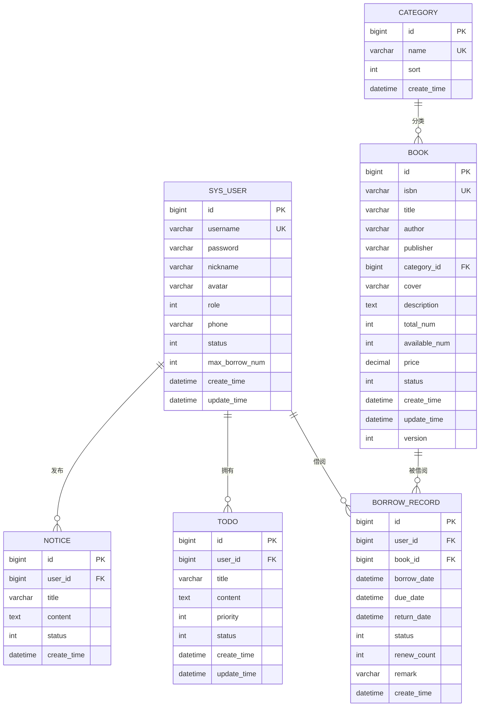

# Todo Management System

[](https://www.oracle.com/java/technologies/downloads/#java17)
[](https://spring.io/projects/spring-boot)
[](https://mybatis.plus/)
[](https://www.mysql.com/)
[](https://jwt.io/)
[](https://springdoc.org/)

---

## 📋 项目概述

**Todo Management System** 是一个综合性的**图书管理与待办事项管理系统**，旨在为图书馆或个人提供图书借阅管理和个人待办事项管理的一体化解决方案。系统采用前后端分离架构，后端基于 Spring Boot 3.2.5 构建，提供完整的 RESTful API 接口。

## ✨ 核心功能

| 模块 | 功能描述 |
| :--- | :--- |
| **用户管理** | 用户注册、登录、信息管理、角色权限控制 |
| **图书管理** | 图书CRUD、状态管理、分类关联 |
| **借阅管理** | 借书、还书、续借、逾期管理 |
| **分类管理** | 图书分类管理 |
| **待办管理** | 个人待办事项管理 |
| **统计分析** | 数据看板、借阅趋势统计 |
| **文件上传** | 图片文件上传（图书封面、用户头像） |

## 🛠️ 技术栈

| 分类 | 技术 | 版本 |
| :--- | :--- | :--- |
| 语言 | Java | 17 |
| 框架 | Spring Boot | 3.2.5 |
| ORM框架 | MyBatis Plus | 3.5.7 |
| 数据库 | MySQL | 8.0+ |
| 认证 | JWT | 0.11.5 |
| API文档 | SpringDoc OpenAPI | 2.3.0 |
| 工具 | Lombok | - |

## 📁 项目结构

```
Todo Management System/
├── todo-common/          # 公共模块
│   ├── exception/        # 自定义异常
│   ├── properties/       # 配置属性类
│   └── util/             # 工具类（JWT、Result、ThreadLocal）
├── todo-entity/          # 实体模块
│   ├── dto/              # 数据传输对象
│   ├── entity/           # 数据库实体类
│   └── vo/               # 视图对象
├── todo-mapper/          # 数据访问模块
│   ├── mapper/           # MyBatis Mapper接口
│   └── resources/        # MyBatis XML映射文件
├── todo-service/         # 业务逻辑模块
│   └── service/          # Service接口与实现
├── todo-web/             # Web应用模块
│   ├── config/           # 配置类（CORS、JWT、MyBatis Plus、OpenAPI）
│   ├── controller/       # REST API控制器
│   ├── exception/        # 全局异常处理
│   └── resources/        # 资源文件（application.yaml）
├── uploads/              # 文件上传目录
├── pom.xml               # 父项目依赖管理
└── mvnw/mvnw.cmd         # Maven Wrapper
```

## 🚀 快速开始

### 环境要求

| 项目 | 要求 |
| :--- | :--- |
| JDK | 17+ |
| MySQL | 8.0+ |
| Maven | 3.8+ |

### 安装与配置

1. **克隆项目**
   ```bash
   git clone https://github.com/your-repo/todo-management-system.git
   cd todo-management-system
   ```

2. **创建数据库**
   ```sql
   CREATE DATABASE todo_db CHARACTER SET utf8mb4 COLLATE utf8mb4_unicode_ci;
   ```

3. **配置数据库连接**

   修改 `todo-web/src/main/resources/application.yaml` 文件：

   ```yaml
   spring:
     datasource:
       url: jdbc:mysql://localhost:3306/todo_db?useUnicode=true&characterEncoding=utf-8&serverTimezone=Asia/Shanghai
       username: your_username
       password: your_password
   ```

4. **配置JWT密钥**

   修改 `application.yaml` 中的JWT配置：

   ```yaml
   jwt:
     secret: your_jwt_secret_key
     expire-time: 86400000  # 24小时（毫秒）
   ```

### 运行项目

**开发环境运行**：
```bash
mvn spring-boot:run
```

**打包构建**：
```bash
mvn clean package
```

**运行打包后的Jar**：
```bash
java -jar todo-web/target/TodoManagementSystem-0.0.1-SNAPSHOT.jar
```

### 访问地址

| 服务 | 地址 |
| :--- | :--- |
| 应用服务 | http://localhost:8080 |
| API文档 | http://localhost:8080/swagger-ui.html |

## 📖 API文档

系统提供完整的RESTful API接口，以下是各模块的主要接口概览：

### 用户管理

| HTTP方法 | 接口路径 | 功能描述 |
| :--- | :--- | :--- |
| POST | `/api/user/register` | 用户注册 |
| POST | `/api/user/login` | 用户登录 |
| GET | `/api/user/info` | 获取用户信息 |
| PUT | `/api/user/info` | 更新用户信息 |
| POST | `/api/user/logout` | 用户登出 |
| GET | `/api/user/page` | 分页查询用户（管理员） |
| POST | `/api/user` | 新增用户（管理员） |
| PUT | `/api/user/{id}` | 修改用户（管理员） |
| PUT | `/api/user/{id}/status` | 更新用户状态（管理员） |
| DELETE | `/api/user/{id}` | 删除用户（管理员） |

### 图书管理

| HTTP方法 | 接口路径 | 功能描述 |
| :--- | :--- | :--- |
| GET | `/api/book/page` | 分页查询图书 |
| GET | `/api/book/{id}` | 获取图书详情 |
| POST | `/api/book` | 新增图书（管理员） |
| PUT | `/api/book/{id}` | 修改图书（管理员） |
| DELETE | `/api/book/{id}` | 删除图书（管理员） |
| PUT | `/api/book/{id}/status` | 更新图书状态（管理员） |

### 借阅管理

| HTTP方法 | 接口路径 | 功能描述 |
| :--- | :--- | :--- |
| POST | `/api/borrow` | 借书 |
| PUT | `/api/borrow/{id}/return` | 还书 |
| PUT | `/api/borrow/{id}/renew` | 续借 |
| GET | `/api/borrow/my-list` | 我的借阅记录 |
| GET | `/api/borrow/page` | 全部借阅记录（管理员） |
| GET | `/api/borrow/overdue` | 逾期列表（管理员） |

### 分类管理

| HTTP方法 | 接口路径 | 功能描述 |
| :--- | :--- | :--- |
| GET | `/api/category/list` | 获取分类列表 |
| GET | `/api/category/{id}` | 获取分类详情 |
| POST | `/api/category` | 新增分类（管理员） |
| PUT | `/api/category/{id}` | 修改分类（管理员） |
| DELETE | `/api/category/{id}` | 删除分类（管理员） |

### 待办管理

| HTTP方法 | 接口路径 | 功能描述 |
| :--- | :--- | :--- |
| GET | `/api/todo/list` | 分页查询待办 |
| POST | `/api/todo/add` | 新增待办 |
| PUT | `/api/todo/update` | 修改待办 |
| DELETE | `/api/todo/delete/{id}` | 删除待办 |
| DELETE | `/api/todo/delete-batch` | 批量删除待办 |
| PUT | `/api/todo/change-status/{id}` | 切换状态 |

### 统计分析

| HTTP方法 | 接口路径 | 功能描述 |
| :--- | :--- | :--- |
| GET | `/api/stat/borrow-trend` | 借阅趋势 |
| GET | `/api/stat/category-ratio` | 分类占比 |
| GET | `/api/stat/hot-books` | 热门图书 |
| GET | `/api/stat/dashboard` | 总体统计 |

### 文件上传

| HTTP方法 | 接口路径 | 功能描述 |
| :--- | :--- | :--- |
| POST | `/api/file/upload` | 图片上传 |

### 认证方式

- **JWT Token认证**：用户登录后返回Token，后续请求需在Header中携带
  ```
  Authorization: Bearer <token>
  ```
- **Token有效期**：24小时（可配置）
- **密码加密**：使用BCrypt算法加密存储

### 角色权限

| 角色 | 标识 | 权限范围 |
| :--- | :--- | :--- |
| 读者 | 0 | 借阅图书、管理个人待办、查看个人信息 |
| 管理员 | 1 | 全部权限，包括用户管理、图书管理、统计分析 |

## 📊 数据库设计

### ER图



## 🔧 业务规则

### 借阅规则

| 规则编号 | 规则描述 |
| :--- | :--- |
| BR-001 | 读者最多可借阅 `maxBorrowNum` 本图书（默认5本） |
| BR-002 | 借阅期限默认为30天 |
| BR-003 | 续借最多2次，每次延长14天 |
| BR-004 | 图书状态为上架且可借数量>0时才能借阅 |
| BR-005 | 逾期图书需先归还才能继续借阅 |
| BR-006 | 用户状态为禁用时不能借阅 |

### 数据校验规则

| 规则编号 | 规则描述 |
| :--- | :--- |
| VR-001 | 用户名长度：3-20字符 |
| VR-002 | 密码长度：6-50字符 |
| VR-003 | ISBN格式校验（10位或13位） |
| VR-004 | 手机号格式校验 |
| VR-005 | 图书价格需≥0 |
| VR-006 | 库存数量需≥0 |

## 🌐 响应格式

### 成功响应

```json
{
  "code": 200,
  "msg": "操作成功",
  "data": {}
}
```

### 失败响应

```json
{
  "code": 400,
  "msg": "参数校验失败",
  "data": null
}
```

### 状态码说明

| 状态码 | 含义 |
| :--- | :--- |
| 200 | 操作成功 |
| 400 | 参数/业务校验失败 |
| 401 | 登录过期/未鉴权 |
| 403 | 权限不足 |
| 500 | 服务异常 |

## 🤝 贡献规范

欢迎贡献代码！请遵循以下规范：

1. **Fork项目**并创建自己的分支
2. 确保代码符合项目的编码规范
3. 添加必要的测试用例
4. 提交PR并描述变更内容

### 代码风格

- Java类名：大驼峰，分层命名统一后缀（如 `UserController`, `UserServiceImpl`）
- 变量/方法名：小驼峰（如 `userName`, `getUserInfo`）
- 数据库表名/字段名：下划线（如 `user_info`, `create_time`）
- 接口路径：小写+横线连接（如 `/api/user/login`）

## 📝 许可证

本项目采用 **MIT License** 许可证。详见 [LICENSE](LICENSE) 文件。

## 📧 联系方式

如有问题或建议，欢迎联系：

- 项目地址：[GitHub Repository](https://github.com/your-repo/todo-management-system)
- 邮件：your-email@example.com

---

⭐ 如果这个项目对你有帮助，请给个Star！
