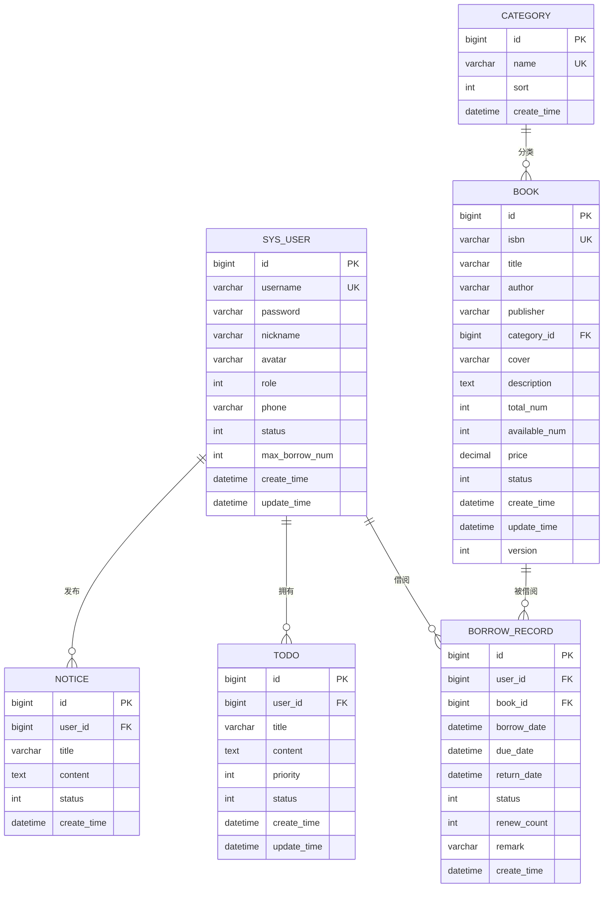

# Todo Management System 需求文档

## 1. 项目概述

### 1.1 项目背景
本系统是一个综合性的**图书管理与待办事项管理系统**，旨在为图书馆或个人提供图书借阅管理和个人待办事项管理的一体化解决方案。

### 1.2 项目名称
Todo Management System

### 1.3 技术架构
| 分类 | 技术 | 版本 |
| :--- | :--- | :--- |
| 语言 | Java | 17 |
| 框架 | Spring Boot | 3.2.5 |
| ORM框架 | MyBatis Plus | 3.5.7 |
| 数据库 | MySQL | 8.0+ |
| 认证 | JWT | 0.11.5 |
| API文档 | SpringDoc OpenAPI | 2.3.0 |
| 工具 | Lombok | - |

### 1.4 运行环境
- **端口**: 8080
- **数据库**: `todo_db` (MySQL)
- **API文档**: `http://localhost:8080/swagger-ui.html`

---

## 2. 功能模块划分

### 2.1 模块总览

| 模块 | 功能描述 | 接口路径 |
| :--- | :--- | :--- |
| **用户管理** | 用户注册、登录、信息管理 | `/api/user` |
| **图书管理** | 图书CRUD、状态管理 | `/api/book` |
| **借阅管理** | 借书、还书、续借、逾期管理 | `/api/borrow` |
| **分类管理** | 图书分类管理 | `/api/category` |
| **待办管理** | 个人待办事项管理 | `/api/todo` |
| **统计分析** | 数据看板、借阅趋势统计 | `/api/stat` |
| **文件上传** | 图片文件上传 | `/api/file` |

---

## 3. 核心功能需求

### 3.1 用户管理模块

#### 3.1.1 功能需求

| 功能点 | 描述 | 权限 |
| :--- | :--- | :--- |
| 用户注册 | 用户通过账号密码注册 | 匿名 |
| 用户登录 | 用户通过账号密码登录，返回JWT令牌 | 匿名 |
| 获取用户信息 | 获取当前登录用户详细信息 | 已登录 |
| 更新用户信息 | 更新昵称、手机号、密码 | 已登录 |
| 用户登出 | 清除登录状态 | 已登录 |
| 分页查询用户 | 分页查询用户列表，支持筛选 | 管理员 |
| 新增用户 | 管理员新增用户 | 管理员 |
| 修改用户 | 管理员修改用户信息 | 管理员 |
| 更新用户状态 | 管理员启用/禁用用户 | 管理员 |
| 删除用户 | 管理员删除用户 | 管理员 |

#### 3.1.2 用户实体结构

| 字段名 | 类型 | 含义 | 约束 |
| :--- | :--- | :--- | :--- |
| id | Long | 用户ID | 主键，自增 |
| username | String | 账号 | 非空，唯一 |
| password | String | 密码（BCrypt加密） | 非空 |
| nickname | String | 昵称 | 可空 |
| avatar | String | 头像URL | 可空 |
| role | Integer | 角色：0-读者，1-管理员 | 默认0 |
| phone | String | 手机号 | 可空 |
| status | Integer | 状态：0-禁用，1-正常 | 默认1 |
| maxBorrowNum | Integer | 最大可借数量 | 默认5 |
| createTime | Date | 创建时间 | 自动生成 |
| updateTime | Date | 更新时间 | 自动更新 |

---

### 3.2 图书管理模块

#### 3.2.1 功能需求

| 功能点 | 描述 | 权限 |
| :--- | :--- | :--- |
| 分页查询图书 | 分页查询图书列表，支持按书名、作者、分类筛选 | 已登录 |
| 获取图书详情 | 根据图书ID获取详细信息 | 已登录 |
| 新增图书 | 添加新图书 | 管理员 |
| 修改图书 | 修改图书信息 | 管理员 |
| 删除图书 | 删除图书记录 | 管理员 |
| 更新图书状态 | 上架/下架图书 | 管理员 |

#### 3.2.2 图书实体结构

| 字段名 | 类型 | 含义 | 约束 |
| :--- | :--- | :--- | :--- |
| id | Long | 图书ID | 主键，自增 |
| isbn | String | ISBN编号 | 非空，唯一 |
| title | String | 书名 | 非空 |
| author | String | 作者 | 非空 |
| publisher | String | 出版社 | 可空 |
| categoryId | Long | 分类ID | 外键 |
| cover | String | 封面图URL | 可空 |
| description | String | 简介 | 可空 |
| totalNum | Integer | 总库存 | 非空，≥0 |
| availableNum | Integer | 可借数量 | 非空，≥0 |
| price | BigDecimal | 价格 | 可空 |
| status | Integer | 状态：0-下架，1-上架 | 默认1 |
| createTime | Date | 创建时间 | 自动生成 |
| updateTime | Date | 更新时间 | 自动更新 |
| version | Integer | 乐观锁版本号 | - |

---

### 3.3 借阅管理模块

#### 3.3.1 功能需求

| 功能点 | 描述 | 权限 |
| :--- | :--- | :--- |
| 借书 | 读者借阅图书，扣减库存 | 已登录（读者） |
| 还书 | 归还图书，恢复库存 | 已登录 |
| 续借 | 延长借阅期限14天，最多续借2次 | 已登录（读者） |
| 我的借阅记录 | 获取当前用户的借阅记录 | 已登录 |
| 全部借阅记录 | 分页获取所有借阅记录 | 管理员 |
| 逾期列表 | 获取所有逾期未还的借阅记录 | 管理员 |

#### 3.3.2 借阅记录实体结构

| 字段名 | 类型 | 含义 | 约束 |
| :--- | :--- | :--- | :--- |
| id | Long | 借阅记录ID | 主键，自增 |
| userId | Long | 借阅人ID | 外键 |
| bookId | Long | 图书ID | 外键 |
| borrowDate | Date | 借阅日期 | 非空 |
| dueDate | Date | 应还日期 | 非空 |
| returnDate | Date | 实际归还日期 | 可空 |
| status | Integer | 状态：0-借阅中，1-已归还，2-已逾期，3-续借中 | 默认0 |
| renewCount | Integer | 续借次数 | 默认0，≤2 |
| remark | String | 备注 | 可空 |
| createTime | Date | 创建时间 | 自动生成 |

---

### 3.4 分类管理模块

#### 3.4.1 功能需求

| 功能点 | 描述 | 权限 |
| :--- | :--- | :--- |
| 获取分类列表 | 获取所有分类 | 已登录 |
| 获取分类详情 | 根据分类ID获取详情 | 已登录 |
| 新增分类 | 添加新分类 | 管理员 |
| 修改分类 | 修改分类信息 | 管理员 |
| 删除分类 | 删除分类（需确保无关联图书） | 管理员 |

#### 3.4.2 分类实体结构

| 字段名 | 类型 | 含义 | 约束 |
| :--- | :--- | :--- | :--- |
| id | Long | 分类ID | 主键，自增 |
| name | String | 分类名称 | 非空，唯一 |
| sort | Integer | 排序号 | 默认0 |
| createTime | Date | 创建时间 | 自动生成 |

---

### 3.5 待办管理模块

#### 3.5.1 功能需求

| 功能点 | 描述 | 权限 |
| :--- | :--- | :--- |
| 分页查询待办 | 分页查询待办列表，支持按标题、状态、优先级筛选 | 已登录 |
| 新增待办 | 添加新待办事项 | 已登录 |
| 修改待办 | 修改待办内容 | 已登录 |
| 删除待办 | 单条删除待办 | 已登录 |
| 批量删除待办 | 批量删除多条待办 | 已登录 |
| 切换状态 | 切换待办完成/未完成状态 | 已登录 |

#### 3.5.2 待办实体结构

| 字段名 | 类型 | 含义 | 约束 |
| :--- | :--- | :--- | :--- |
| id | Long | 待办ID | 主键，自增 |
| userId | Long | 用户ID | 外键 |
| title | String | 待办标题 | 非空 |
| content | String | 待办内容 | 可空 |
| priority | Integer | 优先级：1-高，2-中，3-低 | 默认2 |
| status | Integer | 状态：0-未完成，1-已完成 | 默认0 |
| createTime | Date | 创建时间 | 自动生成 |
| updateTime | Date | 更新时间 | 自动更新 |

---

### 3.6 统计分析模块

#### 3.6.1 功能需求

| 功能点 | 描述 | 权限 |
| :--- | :--- | :--- |
| 借阅趋势 | 获取指定天数内的借阅趋势数据 | 管理员 |
| 分类占比 | 获取图书分类占比统计 | 管理员 |
| 热门图书 | 获取借阅次数最多的TOP10图书 | 管理员 |
| 总体统计 | 获取数据看板总体统计数据 | 管理员 |

---

### 3.7 文件上传模块

#### 3.7.1 功能需求

| 功能点 | 描述 | 权限 |
| :--- | :--- | :--- |
| 图片上传 | 上传图片文件（如图书封面、用户头像） | 已登录 |

---

## 4. 业务规则

### 4.1 借阅规则

| 规则编号 | 规则描述 |
| :--- | :--- |
| BR-001 | 读者最多可借阅 `maxBorrowNum` 本图书（默认5本） |
| BR-002 | 借阅期限默认为30天 |
| BR-003 | 续借最多2次，每次延长14天 |
| BR-004 | 图书状态为上架且可借数量>0时才能借阅 |
| BR-005 | 逾期图书需先归还才能继续借阅 |
| BR-006 | 用户状态为禁用时不能借阅 |

### 4.2 数据校验规则

| 规则编号 | 规则描述 |
| :--- | :--- |
| VR-001 | 用户名长度：3-20字符 |
| VR-002 | 密码长度：6-50字符 |
| VR-003 | ISBN格式校验（10位或13位） |
| VR-004 | 手机号格式校验 |
| VR-005 | 图书价格需≥0 |
| VR-006 | 库存数量需≥0 |

---

## 5. 数据库设计

### 5.1 表关系图



---

## 6. API接口列表

### 6.1 用户管理接口

| HTTP方法 | 接口路径 | 功能描述 |
| :--- | :--- | :--- |
| POST | `/api/user/register` | 用户注册 |
| POST | `/api/user/login` | 用户登录 |
| GET | `/api/user/info` | 获取用户信息 |
| PUT | `/api/user/info` | 更新用户信息 |
| POST | `/api/user/logout` | 用户登出 |
| GET | `/api/user/page` | 分页查询用户（管理员） |
| POST | `/api/user` | 新增用户（管理员） |
| PUT | `/api/user/{id}` | 修改用户（管理员） |
| PUT | `/api/user/{id}/status` | 更新用户状态（管理员） |
| DELETE | `/api/user/{id}` | 删除用户（管理员） |

### 6.2 图书管理接口

| HTTP方法 | 接口路径 | 功能描述 |
| :--- | :--- | :--- |
| GET | `/api/book/page` | 分页查询图书 |
| GET | `/api/book/{id}` | 获取图书详情 |
| POST | `/api/book` | 新增图书（管理员） |
| PUT | `/api/book/{id}` | 修改图书（管理员） |
| DELETE | `/api/book/{id}` | 删除图书（管理员） |
| PUT | `/api/book/{id}/status` | 更新图书状态（管理员） |

### 6.3 借阅管理接口

| HTTP方法 | 接口路径 | 功能描述 |
| :--- | :--- | :--- |
| POST | `/api/borrow` | 借书 |
| PUT | `/api/borrow/{id}/return` | 还书 |
| PUT | `/api/borrow/{id}/renew` | 续借 |
| GET | `/api/borrow/my-list` | 我的借阅记录 |
| GET | `/api/borrow/page` | 全部借阅记录（管理员） |
| GET | `/api/borrow/overdue` | 逾期列表（管理员） |

### 6.4 分类管理接口

| HTTP方法 | 接口路径 | 功能描述 |
| :--- | :--- | :--- |
| GET | `/api/category/list` | 获取分类列表 |
| GET | `/api/category/{id}` | 获取分类详情 |
| POST | `/api/category` | 新增分类（管理员） |
| PUT | `/api/category/{id}` | 修改分类（管理员） |
| DELETE | `/api/category/{id}` | 删除分类（管理员） |

### 6.5 待办管理接口

| HTTP方法 | 接口路径 | 功能描述 |
| :--- | :--- | :--- |
| GET | `/api/todo/list` | 分页查询待办 |
| POST | `/api/todo/add` | 新增待办 |
| PUT | `/api/todo/update` | 修改待办 |
| DELETE | `/api/todo/delete/{id}` | 删除待办 |
| DELETE | `/api/todo/deleteBatch` | 批量删除待办 |
| PUT | `/api/todo/changeStatus/{id}` | 切换状态 |

### 6.6 统计分析接口

| HTTP方法 | 接口路径 | 功能描述 |
| :--- | :--- | :--- |
| GET | `/api/stat/borrow-trend` | 借阅趋势 |
| GET | `/api/stat/category-ratio` | 分类占比 |
| GET | `/api/stat/hot-books` | 热门图书 |
| GET | `/api/stat/dashboard` | 总体统计 |

### 6.7 文件上传接口

| HTTP方法 | 接口路径 | 功能描述 |
| :--- | :--- | :--- |
| POST | `/api/file/upload` | 图片上传 |

---

## 7. 安全与权限

### 7.1 认证机制

- **JWT Token认证**：用户登录后返回Token，后续请求需在Header中携带 `Authorization: Bearer <token>`
- **Token有效期**：24小时（可配置）
- **密码加密**：使用BCrypt算法加密存储

### 7.2 角色权限

| 角色 | 标识 | 权限范围 |
| :--- | :--- | :--- |
| 读者 | 0 | 借阅图书、管理个人待办、查看个人信息 |
| 管理员 | 1 | 全部权限，包括用户管理、图书管理、统计分析 |

### 7.3 安全措施

| 措施 | 说明 |
| :--- | :--- |
| SQL注入防护 | 使用MyBatis Plus参数化查询 |
| XSS防护 | 输入内容过滤 |
| CORS配置 | 允许跨域请求 |
| 文件上传限制 | 限制文件大小（最大10MB）和类型 |

---

## 8. 配置说明

### 8.1 数据库连接信息

```yaml
spring:
  datasource:
    url: jdbc:mysql://localhost:3306/todo_db?useUnicode=true&characterEncoding=utf-8&serverTimezone=Asia/Shanghai
    username: root
    password: 123456
    driver-class-name: com.mysql.cj.jdbc.Driver
```

### 8.2 JWT配置

```yaml
jwt:
  secret: todoSystemJwtSecretKey1234567890abcdef
  expire-time: 86400000  # 24小时（毫秒）
```

---

## 9. 部署与运行

### 9.1 环境要求

| 项目 | 要求 |
| :--- | :--- |
| JDK | 17+ |
| MySQL | 8.0+ |
| Maven | 3.8+ |

### 9.2 启动方式

**开发环境运行**：
```bash
cd TodoManagementSystem
mvn spring-boot:run
```

**打包构建**：
```bash
mvn clean package
```

**运行打包后的Jar**：
```bash
java -jar target/TodoManagementSystem-0.0.1-SNAPSHOT.jar
```

---

## 10. 附录

### 10.1 状态码说明

| 状态码 | 含义 |
| :--- | :--- |
| 0 | 成功 |
| 1 | 失败 |
| 401 | 未登录/Token过期 |
| 403 | 无权限 |

### 10.2 响应格式

```json
{
  "code": 0,
  "message": "success",
  "data": {}
}
```